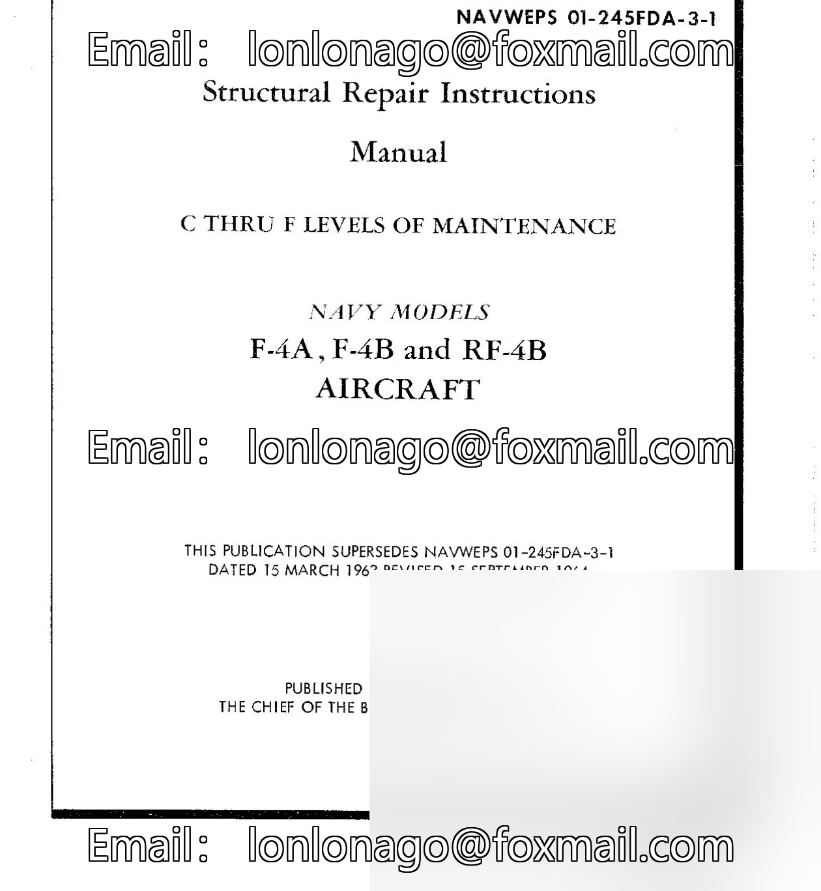
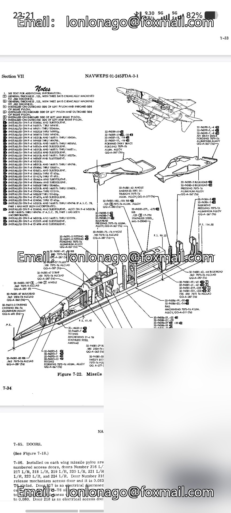
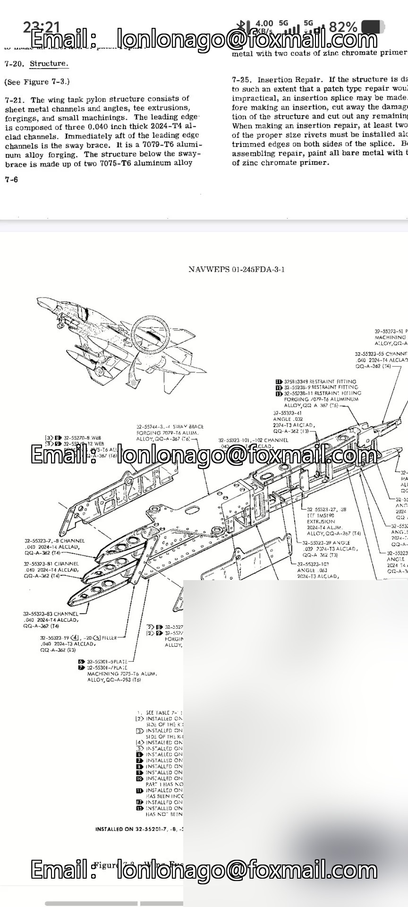
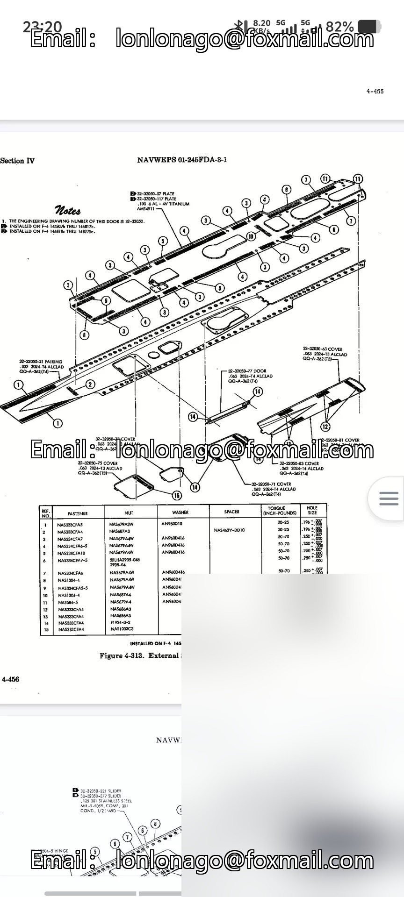

# The structural repair manual for US Navy F-4A, F-4B, and RF-4B aircraft

## Body

The F-4A, F-4B, and RF-4B Navy Air Force Aircraft Structural Repair Manual
1. Content
1. Detailed structural diagrams, maintenance processes, and repair standards
2. Suitable for aviation maintenance, structural repair, and history enthusiasts
3. PDF , complete content, can be copied
2. Characteristics of the materials
Authority: Issued officially, content covers aircraft structure, maintenance, and repair standards
Practicality: Suitable for military, aviation, and maintenance professional reference
3. , non-returnable upon sale
Must be photographed directly, contact privately if there are any questions

The manual covers structural repair, maintenance procedures and repair standards for F-4A, F-4B and RF-4B aircraft, suitable for aviation maintenance, structural repair and historical data enthusiasts, and is a sold publication.

<!-- AI_ENRICHED -->

## Images

## Payment

Here is a pay link on Stripe ( https://buy.stripe.com/3cs8yP7sY87d0vu9AB ). Please contact me lonlonago@foxmail.com after funding $89, and I will send you a complete data files , thank you!

